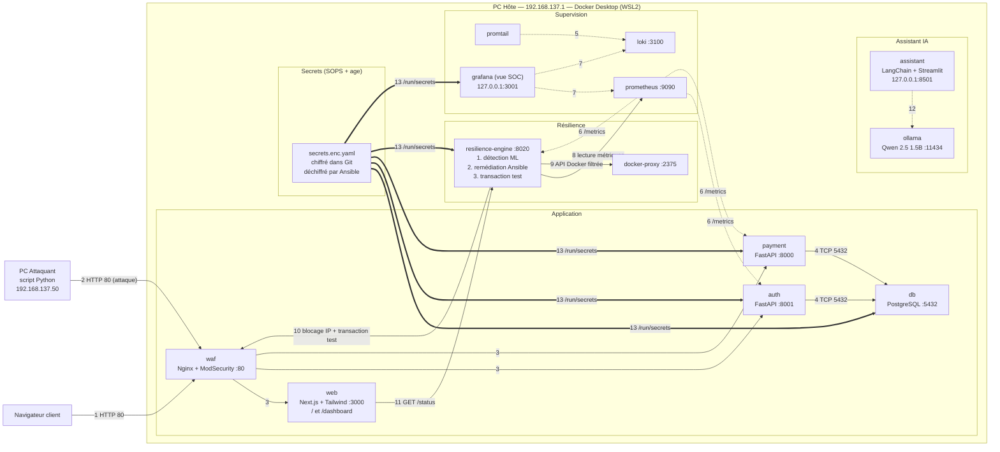

# Architecture technique — PROJECT RESILIENCE-ALPHA

> Groupe G<n> • Version 2.1 (simplifiée) du 19/10/2026 • Rédaction : Timéo (Lead Transformation & PMO) • Statut : à valider par le coach

## 1. Vue d'ensemble

**2 PC, 13 conteneurs, 1 seul port ouvert au réseau.** Tout tourne sur le PC Hôte avec un seul `docker compose up`. Le PC Attaquant (script Python) ne voit que le WAF. Les secrets sont chiffrés avec SOPS.



## 2. Les machines

| Machine                                                                      | Adresse IP                                        | Ce qui y tourne                                                                                                                       | Responsable |
| ---------------------------------------------------------------------------- | ------------------------------------------------- | ------------------------------------------------------------------------------------------------------------------------------------- | ----------- |
| PC Hôte (Windows, Docker Desktop + WSL2, 16 Go RAM min.)                    | **192.168.137.1** (imposée par le hotspot) | Les 13 conteneurs + le point d'accès « RESILIENCE-G<n> » + la clé de déchiffrement SOPS                                      | Mélanie    |
| PC Attaquant (n'importe quel OS avec Python 3, environnement virtuel isolé) | **192.168.137.50** (fixe)                   | Deux scripts Python : `traffic.py` (trafic légitime) et `attack.py` (attaque). Seule cible autorisée : `http://192.168.137.1` | Clara       |
| *PC IA (facultatif, plan B)*                                               | *192.168.137.20*                                | *Seulement si le PC Hôte manque de RAM : on y déplace le conteneur ollama*                                                        | Agathe      |

## 3. Les 13 conteneurs

| Bloc         | Conteneur                   | Techno                           | Port  | Accessible depuis                                              | Rôle                                                           | Resp.             |
| ------------ | --------------------------- | -------------------------------- | ----- | -------------------------------------------------------------- | --------------------------------------------------------------- | ----------------- |
| Application  | **waf**               | Nginx + ModSecurity (OWASP CRS)  | 80    | **Réseau (0.0.0.0:80)**                                 | Seule porte d'entrée : filtre, limite le débit, bannit des IP | Clara             |
| Application  | **web**               | Next.js + Tailwind               | 3000  | Via le WAF (`/`) • `/dashboard` en local (127.0.0.1:3000) | Page de paiement + dashboard 4 zones                            | Antoine           |
| Application  | **auth**              | FastAPI                          | 8001  | Via le WAF (`/api/auth`)                                     | Connexion, jeton JWT                                            | Antoine           |
| Application  | **payment**           | FastAPI                          | 8000  | Via le WAF (`/api/pay`)                                      | Transactions, `/health`, `/metrics`                         | Antoine           |
| Application  | **db**                | PostgreSQL                       | 5432  | Interne                                                        | Données fictives                                               | Antoine           |
| Supervision  | **prometheus**        | Prometheus                       | 9090  | Interne                                                        | Métriques toutes les 5 s                                       | Mélanie          |
| Supervision  | **loki**              | Loki                             | 3100  | Interne                                                        | Journaux centralisés                                           | Mélanie          |
| Supervision  | **promtail**          | Promtail                         | —    | Interne                                                        | Envoie les journaux de tous les conteneurs à Loki              | Mélanie          |
| Supervision  | **grafana**           | Grafana                          | 3000  | Local (127.0.0.1:3001)                                         | Tableaux de bord + vue SOC (fonction SIEM)                      | Mélanie / Clara  |
| Résilience  | **resilience-engine** | FastAPI + scikit-learn + Ansible | 8020  | Interne                                                        | Détecte (ML), répare (Ansible), vérifie (transaction test)   | Agathe + Mélanie |
| Résilience  | **docker-proxy**      | tecnativa/docker-socket-proxy    | 2375  | Interne                                                        | Seule voie vers Docker, limitée au redémarrage                | Mélanie          |
| Assistant IA | **ollama**            | Ollama + Qwen 2.5 1.5B           | 11434 | Interne                                                        | Modèle de langage local                                        | Agathe            |
| Assistant IA | **assistant**         | LangChain + Streamlit            | 8501  | Local (127.0.0.1:8501)                                         | Répond aux opérateurs à partir de `docs/`                  | Agathe            |

- **Réseaux Docker** : `front` et `back` (`back` en `internal: true`). db, prometheus, loki, promtail et docker-proxy ne sont que sur `back`.
- **Playbooks Ansible** : `deploy.yml` (tout installer), `reset.yml` (remettre la démo à zéro), `remediate.yml` (actions de réparation, lancées par resilience-engine).

## 4. Gestion des secrets avec SOPS (obligatoire)

Les secrets ne sont **jamais** en clair dans Git ni dans des variables d'environnement. Ils sont chiffrés avec SOPS, déchiffrés uniquement sur le PC Hôte au déploiement, puis donnés **à chaque service qui en a besoin, et à lui seul**, sous forme de fichier. Responsable : Clara.

| Secret                                     | Reçu par                 | Fichier dans le conteneur               | Pourquoi                                                    |
| ------------------------------------------ | ------------------------- | --------------------------------------- | ----------------------------------------------------------- |
| Mot de passe administrateur PostgreSQL     | db                        | `/run/secrets/db_admin_password`      | Initialisation de la base uniquement                        |
| Mot de passe du compte SQL `auth_svc`    | auth                      | `/run/secrets/db_auth_password`       | Accès limité à la table `users`                        |
| Mot de passe du compte SQL `payment_svc` | payment                   | `/run/secrets/db_payment_password`    | Accès limité aux tables `accounts` et `transactions`  |
| **Clé privée JWT** (RS256)         | **auth uniquement** | `/run/secrets/jwt_private_key`        | Seul auth peut **signer** un jeton                    |
| Clé publique JWT                          | payment                   | `/run/secrets/jwt_public_key`         | payment peut **vérifier** un jeton, pas en fabriquer |
| Mot de passe du compte de test             | resilience-engine         | `/run/secrets/test_account_password`  | Transaction test après remédiation                        |
| Mot de passe admin Grafana                 | grafana                   | `/run/secrets/grafana_admin_password` | Accès à la vue SOC                                        |

**Le circuit, étape par étape :**

1. **Chiffrement** : tous les secrets sont dans `secrets.enc.yaml`, chiffré avec SOPS et une clé **age**. Ce fichier chiffré est commité dans Git.
2. **Clé de déchiffrement** : la clé privée age n'existe que sur le PC Hôte (`~/.config/sops/age/keys.txt`). Jamais dans Git, jamais envoyée à une IA.
3. **Déchiffrement** : `ansible-playbook deploy.yml` déchiffre le fichier (module `community.sops`) vers `secrets/` (droits 600, dans le `.gitignore`).
4. **Distribution** : docker compose monte chaque fichier en lecture seule dans `/run/secrets/`, et seulement dans le conteneur concerné. Les secrets n'apparaissent pas dans `docker inspect`.
5. **Rotation** : modifier `secrets.enc.yaml` puis relancer `deploy.yml`. C'est aussi la réponse prévue en cas de fuite de secret (scénario de compromission, différent d'une simple indisponibilité).

Si l'équipe préfère Vault, il remplace SOPS sans changer le reste du schéma (un conteneur `vault` en plus sur le réseau `back`).

## 5. Les 13 flux

| N° | De                                     | Vers                                          | Protocole / port                       | Pour quoi faire                                                                          |
| --- | -------------------------------------- | --------------------------------------------- | -------------------------------------- | ---------------------------------------------------------------------------------------- |
| 1   | Navigateur client                      | waf                                           | HTTP / 80                              | Connexion et paiement                                                                    |
| 2   | **PC Attaquant** (script Python) | waf                                           | HTTP / 80                              | **Attaque** : flood sur `/api/pay` ou force brute sur `/api/auth/login`        |
| 3   | waf                                    | web, auth, payment                            | HTTP / 3000, 8001, 8000                | Transmission des requêtes autorisées                                                   |
| 4   | auth, payment                          | db                                            | TCP / 5432                             | Lecture et écriture des données (pool de connexions limité)                           |
| 5   | promtail                               | loki                                          | HTTP / 3100                            | Journaux de tous les conteneurs (dont le WAF)                                            |
| 6   | prometheus                             | auth, payment, resilience-engine              | HTTP / `/metrics`                    | Métriques toutes les 5 s                                                                |
| 7   | grafana                                | prometheus, loki                              | HTTP / 9090, 3100                      | Tableaux de bord et vue SOC                                                              |
| 8   | resilience-engine                      | prometheus                                    | HTTP / 9090                            | Indicateurs pour le modèle ML (toutes les 10 s, aucune requête vers PostgreSQL)        |
| 9   | resilience-engine                      | docker-proxy                                  | HTTP / 2375                            | Redémarrage d'un conteneur, rechargement du WAF (via Ansible)                           |
| 10  | resilience-engine                      | waf                                           | HTTP / 80                              | IP en liste noire + **transaction test** de bout en bout                           |
| 11  | web (`/dashboard`)                   | resilience-engine                             | HTTP / 8020 `GET /status`            | État, score ML, étapes de reprise en direct                                            |
| 12  | assistant                              | ollama                                        | HTTP / 11434                           | Questions au modèle de langage                                                          |
| 13  | SOPS + Ansible (`deploy.yml`)        | db, auth, payment, grafana, resilience-engine | Fichiers montés dans `/run/secrets` | **Distribution des secrets** au déploiement (mots de passe PostgreSQL, clés JWT) |

Tout flux absent de ce tableau est interdit.

## 6. Ce qui se passe pendant la démo

| Étape          | Ce qui se passe                                                                                           | Où on le voit                     |
| --------------- | --------------------------------------------------------------------------------------------------------- | ---------------------------------- |
| 0. Normal       | `traffic.py` envoie du trafic légitime, les paiements passent                                          | Dashboard tout vert                |
| 1. Attaque      | Clara lance `attack.py` depuis le PC Attaquant (flux 2)                                                 | Terminal de l'attaquant            |
| 2. Détection   | resilience-engine lit Prometheus, le modèle Isolation Forest classe la situation comme anormale (flux 8) | Dashboard : score ML en rouge      |
| 3. Remédiation | Le playbook Ansible bannit l'IP au WAF et redémarre le service s'il ne répond plus (flux 9, 10)         | Dashboard : étapes en cours       |
| 4. Preuve       | Transaction test complète via le WAF : connexion + paiement (flux 10)                                    | Dashboard : « SERVICE RÉTABLI » |
| 5. Mesure       | Temps de détection et de reprise, comparés au RTO du PCA                                                | Grafana + dossier                  |

## 7. Performances : tenir la charge sur un seul PC

Les 13 conteneurs partagent la mémoire et le processeur du PC Hôte. L'attaque crée un pic de charge : la plateforme doit rester fluide pour que la détection, la remédiation et la transaction test aient lieu à temps.

### PostgreSQL (Antoine)

- **Requêtes avec des CTE directes** plutôt que des vues lourdes. Depuis PostgreSQL 12, une CTE simple est intégrée à la requête par l'optimiseur : lisible et sans coût supplémentaire.
- **Un paiement = une seule requête atomique** (débit + enregistrement) : un seul aller-retour, pas d'incohérence possible.
- **Index utiles et seulement eux** : `users(username)` unique, `transactions(account_id, created_at DESC)`, `transactions(created_at)`. Chaque index ralentit les écritures, donc pas d'index « au cas où ».
- **Pool de connexions** limité (5 à 10 par service) et **`statement_timeout` de 2 s** : sous attaque, les requêtes en trop attendent ou échouent vite au lieu de saturer la base.
- Vérifier chaque requête importante avec `EXPLAIN ANALYZE` (aucun parcours complet de la table `transactions`).
- Le **modèle ML ne requête jamais PostgreSQL** : il lit Prometheus. La base ne sert qu'aux paiements.

Exemple : un paiement en une requête (si le solde est insuffisant, rien n'est inséré).

```sql
WITH debit AS (
  UPDATE accounts
     SET balance = balance - :amount
   WHERE id = :account_id
     AND balance >= :amount
  RETURNING id
)
INSERT INTO transactions (account_id, amount, recipient)
SELECT id, :amount, :recipient FROM debit
RETURNING id, created_at;
```

### Budget par conteneur (Mélanie)

| Conteneur                  | RAM max             | CPU max |
| -------------------------- | ------------------- | ------- |
| ollama                     | 2,5 Go              | 2       |
| assistant                  | 768 Mo              | 0,5     |
| db                         | 512 Mo              | 1       |
| prometheus                 | 512 Mo              | 0,5     |
| resilience-engine          | 512 Mo              | 0,5     |
| loki                       | 384 Mo              | 0,5     |
| web                        | 384 Mo              | 0,5     |
| waf, grafana               | 256 Mo chacun       | 0,5     |
| auth, payment              | 192 Mo chacun       | 0,5     |
| promtail, docker-proxy     | 128 / 32 Mo         | 0,25    |
| **Total conteneurs** | **≈ 6,6 Go** |         |

- Plafonds fixés dans le docker-compose (`mem_limit`, `cpus`) : un conteneur emballé ne peut pas faire tomber les autres.
- WSL2 limité à 10 Go (fichier `.wslconfig`) pour garder Windows réactif.
- Rétention courte : 24 h pour Prometheus et Loki.
- Le WAF limite le débit par IP : il protège la base avant même la remédiation.
- Valeurs de départ, à ajuster mardi avec `docker stats`.

## 8. Conformité au sujet

| Exigence du sujet                                                                    | Notre réponse                                                                                           |
| ------------------------------------------------------------------------------------ | -------------------------------------------------------------------------------------------------------- |
| Microservices : base, API métier, authentification, frontal web                     | db, payment, auth, web                                                                                   |
| Node.js / FastAPI / Go • dashboard React + Tailwind                                 | FastAPI • Next.js (React) + Tailwind                                                                    |
| Moteur de remédiation + interface de supervision                                    | resilience-engine + page `/dashboard`                                                                  |
| Docker Compose + playbooks Ansible                                                   | 1 `docker-compose.yml` • `deploy.yml`, `reset.yml`, `remediate.yml`                             |
| Prometheus, Grafana, Loki (pas d'Elastic)                                            | prometheus, grafana, loki + promtail                                                                     |
| Détection ML (pas de seuils en dur), branchée sur la remédiation                  | Isolation Forest dans resilience-engine                                                                  |
| RAG Ollama + LangChain, ≤ 8B, séparé de la remédiation, sans accès privilégié | assistant + ollama (Qwen 2.5 1.5B), lecture seule de `docs/`                                           |
| Attaque depuis un PC distinct                                                        | Script Python sur le PC Attaquant → WAF                                                                 |
| WAF, SIEM/SOC, durcissement                                                          | ModSecurity • vue SOC Grafana • non-root, ports fermés, budgets de ressources                         |
| **Gestion des secrets : HashiCorp Vault ou SOPS**                              | **SOPS + age** : secrets chiffrés dans Git, distribués par fichiers `/run/secrets` (section 4) |
| Accès du moteur de remédiation maîtrisés                                         | docker-proxy filtré • aucune route d'action exposée                                                   |
| Hotspot, PC Hôte en 192.168.137.1, services internes non exposés                   | Seul le port 80 du WAF est ouvert                                                                        |
| Reprise prouvée par une nouvelle transaction                                        | Transaction test automatique                                                                             |

## 9. Ce qu'on a simplifié (et pourquoi)

- **Pas de PC IA** : un modèle de 1,5B tient dans les 16 Go du PC Hôte. Le PC IA reste un plan B.
- **Détection et remédiation dans un seul service** : pas de format d'alerte à négocier, pas de token entre services, rien ne peut ordonner une réparation de l'extérieur. Agathe code le module de détection, Mélanie le module de remédiation.
- **Paiement et dashboard dans la même application Next.js** : un seul projet front. Le WAF bloque `/dashboard` depuis le réseau.
- **SOPS au lieu de Vault** : aucun conteneur, secrets chiffrés dans Git.
- **2 réseaux Docker**, pas de cAdvisor, HTTP au lieu de HTTPS (cité comme amélioration dans les limites).

## 10. À vérifier dès aujourd'hui

- [ ] Le WAF voit-il la vraie IP de l'attaquant ? Docker Desktop peut la masquer. Plan B : bloquer par compte ou par jeton.
- [ ] RAM réelle du PC Hôte avec les 13 conteneurs (`docker stats`). Si ça coince, ollama passe sur le PC IA.
- [ ] Générer la clé age sur le PC Hôte et chiffrer un premier `secrets.enc.yaml` (Clara + Mélanie).
- [ ] Validation du schéma par le coach.
