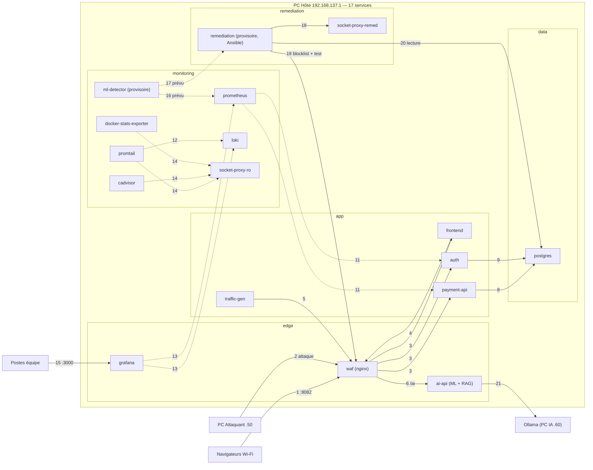

# Architecture technique telle que construite — PROJECT RESILIENCE-ALPHA

> Groupe G4 • v3 (telle que construite) • code main 2016dc1 • 21/10/2026 • Rédaction : Timéo (Lead Transformation & PMO)
> Source : `docker-compose.yml` et le code du dépôt. La cible validée le 19/10 (v2.1) et les écarts sont en section 7.

## 1. Machines et réseau du labo

| Machine | Adresse IP | Rôle | Responsable |
|---|---|---|---|
| **PC Hôte** (Windows + WSL2 + Docker Desktop) | **192.168.137.1** | Point d'accès Wi-Fi **RESILIENCE-G4** + les 17 services Docker | Mélanie |
| **PC Attaquant** | **192.168.137.50** | Scripts Python de trafic et d'attaque (scripts/red_attack.py, normal_traffic.py) | Clara |
| **PC IA** | 192.168.137.60 | Ollama (modèle qwen2.5:1.5b) pour l'assistant RAG, hors Docker | Agathe |
| Postes équipe | 192.168.137.101 / .102 | Développement, accès à Grafana | Antoine, Timéo |

IP fixes configurées à la main sur chaque PC (le hotspot Windows ne permet pas de réservation DHCP). Détails et commandes : *docs/plan-adressage.md*.

## 2. Ports publiés sur le PC Hôte

| Port hôte | Service | Joignable depuis | Protection |
|---|---|---|---|
| **8082** | waf (point d'entrée unique) | Tout le Wi-Fi, y compris l'attaquant | Liste blanche de routes, liste de blocage, IP source non falsifiable |
| **3000** | grafana (supervision) | Tout le Wi-Fi (règle Docker Desktop du pare-feu) | Compte obligatoire, pas d'accès anonyme ni d'inscription |
| 127.0.0.1:8001 | ai-api | PC Hôte uniquement | Invisible depuis le Wi-Fi |
| — | postgres, payment-api, auth, prometheus, loki, remediation… | Jamais | Aucune directive ports: dans le compose |

## 3. Réseaux Docker (5 zones)

| Réseau | Sous-réseau | Interne | Membres |
|---|---|---|---|
| **edge** | 10.77.10.0/24 | non | waf, grafana, ai-api (seul réseau avec une sortie) |
| **app** | 10.77.20.0/24 | oui | waf, frontend, payment-api, auth, traffic-gen, prometheus, ai-api, remediation |
| **data** | 10.77.30.0/24 | oui | postgres, payment-api, auth, remediation |
| **monitoring** | 10.77.40.0/24 | oui | prometheus, grafana, loki, promtail, cadvisor, docker-stats-exporter, socket-proxy-ro, ml-detector, remediation |
| **remediation** | 10.77.50.0/24 | oui | remediation, socket-proxy-remed (seul accès au redémarrage des conteneurs) |

## 4. Les 17 services

| Service | Techno (code) | Port | Réseaux | Rôle | État | Resp. |
|---|---|---|---|---|---|---|
| **waf** | nginx-unprivileged 1.28 | 8080 | edge, app | Liste blanche : /, /api/{pay,health,transactions,waf/status}, /auth/*, /ai/* ; inclut la liste de blocage | ✅ Fait | Mélanie, Clara |
| **frontend** | React + Vite + Tailwind | 3000 | app | Paiement, compte, dashboard ; appelle /api, /auth, /ai via le waf | ✅ Fait | Antoine |
| **payment-api** | FastAPI (backend/) | 8000 | app, data | Paiements, débit du solde si client authentifié, limitation de débit, /metrics | ✅ Fait | Antoine, Clara |
| **auth** | FastAPI (backend-auth/) | 8001 | app, data | Inscription, connexion (mots de passe scrypt, verrouillage après 5 échecs), JWT HS256, solde, dépôt | ✅ Fait | Antoine |
| **postgres** | PostgreSQL 16.10 | 5432 | data | Comptes, transactions, journal d'audit ; rôle remediation_ro en lecture | ✅ Fait | Antoine, Mélanie |
| **traffic-gen** | Python | — | app | Trafic normal : 1 paiement toutes les 2 s via le waf | ✅ Fait | Mélanie |
| **prometheus** | Prometheus 3.5 | 9090 | app, monitoring | Collecte des métriques toutes les 15 s | ✅ Fait | Mélanie |
| **loki** | Loki 3.5 | 3100 | monitoring | Centralisation des journaux | ✅ Fait | Mélanie |
| **promtail** | Promtail 3.5 | 9080 | monitoring | Lit les journaux des conteneurs et les envoie à Loki | ✅ Fait | Mélanie |
| **grafana** | Grafana 12.1 | 3000 | edge, monitoring | Tableaux de bord, vue SOC | ✅ Fait | Mélanie, Clara |
| **cadvisor** | cAdvisor 0.52 | 8080 | monitoring | Métriques des conteneurs | ✅ Fait | Mélanie |
| **docker-stats-exporter** | Python | 9105 | monitoring | Métriques par conteneur (Docker Desktop) | ✅ Fait | Mélanie |
| **socket-proxy-ro** | tecnativa 0.4.1 | 2375 | monitoring | Accès Docker en lecture seule pour la supervision | ✅ Fait | Mélanie |
| **ai-api** | FastAPI, scikit-learn, LangChain, FAISS | 8000 | edge, app | Détection (Isolation Forest pré-entraîné) + assistant RAG (procedures.pdf) | ⚠️ Partiel | Agathe |
| **ml-detector** | conteneur provisoire | 8010 | monitoring | Doit lire Prometheus/Loki et prévenir remediation | 🚧 Provisoire | équipe IA |
| **remediation** | provisoire + Ansible | 8020 | monitoring, remediation, app, data | Playbooks prêts (restart, block, restore) ; moteur à écrire | 🚧 Provisoire | équipe Dev |
| **socket-proxy-remed** | wollomatic 1.13 | 2375 | remediation | N'autorise que la lecture et le redémarrage, depuis remediation seulement | ✅ Fait | Mélanie |

## 5. Matrice des flux

Les numéros correspondent aux pastilles du schéma. Tout flux absent est interdit (pas de réseau commun ou réseau interne).

| N° | Source | Destination | Port | Objet | État |
|---|---|---|---|---|---|
| 1 | Wi-Fi (navigateurs) | waf | 8082 | Accès à la plateforme : front, API, auth, assistant | ✅ Fait |
| 2 | **PC Attaquant .50** | waf | 8082 | **Attaque de démo** (flood sur /api/pay) | ✅ Fait |
| 3 | waf | frontend, payment-api, auth | 3000, 8000, 8001 | Routes autorisées uniquement (le reste répond 403) | ✅ Fait |
| 4 | frontend | waf | 8080 | Proxy du front : /api, /auth, /ai repassent par le waf | ✅ Fait |
| 5 | traffic-gen | waf | 8080 | Trafic normal, par le même chemin qu'un client | ✅ Fait |
| 6 | waf | ai-api | 8000 | Assistant et détection via /ai/* | ✅ Fait |
| 7 | navigateur du PC Hôte | ai-api | 127.0.0.1:8001 | Accès direct local (non publié sur le Wi-Fi) | ✅ Fait |
| 8 | payment-api | postgres | 5432 | Transactions et débit du solde | ✅ Fait |
| 9 | auth | postgres | 5432 | Comptes, soldes, mots de passe hachés | ✅ Fait |
| 10 | payment-api | (aucun appel à auth) | — | Le jeton JWT est vérifié localement avec le secret partagé | ✅ Fait |
| 11 | prometheus | payment-api, auth, cadvisor, docker-stats, loki, promtail, ml-detector, remediation | /metrics | Collecte des métriques (ai-api n'est pas collecté) | ⚠️ Partiel |
| 12 | promtail | loki | 3100 | Envoi des journaux | ✅ Fait |
| 13 | grafana | prometheus, loki | 9090, 3100 | Tableaux de bord et vue SOC | ✅ Fait |
| 14 | promtail, cadvisor, docker-stats | socket-proxy-ro | 2375 | Lecture des conteneurs (GET seulement) | ✅ Fait |
| 15 | Postes équipe | grafana | 3000 | Supervision avec compte | ✅ Fait |
| 16 | ml-detector | prometheus, loki | 9090, 3100 | Lecture des signaux pour la détection | ⏳ Prévu |
| 17 | ml-detector | remediation | 8020 | Déclenchement d'une action, avec jeton | ⏳ Prévu |
| 18 | remediation | socket-proxy-remed | 2375 | Redémarrage d'un conteneur en liste blanche | ✅ Fait |
| 19 | remediation | waf (volume + réseau app) | fichier, 8080 | Règle de blocage écrite dans le volume waf-blocklist + paiement de test | ✅ Fait |
| 20 | remediation | postgres | 5432 | Contrôle d'intégrité, compte remediation_ro en lecture | ✅ Fait |
| 21 | ai-api | Ollama (PC IA ou hôte) | 11434 | Génération des réponses de l'assistant, seule sortie vers l'extérieur | ✅ Fait |

> **À noter :** Le plan d'adressage de Mélanie indique un flux payment-api → auth (vérification des jetons). Dans le code, payment-api vérifie le jeton lui-même avec le secret partagé et n'appelle jamais auth. À aligner dans *docs/plan-adressage.md*.

## 6. Sécurité en place (vérifiée dans le code)

| Mesure | Où dans le code | État |
|---|---|---|
| Un seul point d'entrée, liste blanche de routes (/api/docs, /api/metrics, /api/waf/block → 403) | infra/placeholders/waf/default.conf | ✅ Fait |
| IP source non falsifiable : X-Forwarded-For forcé à l'IP vue par le WAF | default.conf (proxy_set_header … $remote_addr) | ✅ Fait |
| Liste de blocage dynamique (IP, User-Agent, limitation) écrite par Ansible | ansible/roles/waf_blocklist + volume waf-blocklist | ✅ Fait |
| Limitation de débit : 40 requêtes / 2 s par client sur /pay | backend/app/waf.py | ✅ Fait |
| Routes /waf/block et /waf/unblock protégées par jeton (REMEDIATION_TOKEN) | backend/app/main.py | ✅ Fait |
| simulate_failure ignoré sauf si CHAOS_MODE_ENABLED=true côté serveur | backend/app/services.py | ✅ Fait |
| Authentification : mots de passe scrypt, verrouillage après 5 échecs par compte, jeton JWT HS256, débit du solde | backend-auth/app/main.py, backend/app/auth.py | ✅ Fait |
| Paiements anonymes encore acceptés (REQUIRE_AUTH=false par défaut) | docker-compose.yml | ⚠️ Partiel |
| Base non publiée, rôle remediation_ro en lecture pour la remédiation | docker-compose.yml, infra/postgres | ✅ Fait |
| Accès Docker par proxys : lecture seule (supervision), redémarrage seul (remédiation) | docker-compose.yml | ✅ Fait |
| Conteneurs durcis : no-new-privileges, read_only et cap_drop sur la plupart, limites CPU/RAM sur certains | docker-compose.yml | ⚠️ Partiel |
| Secrets : .env.enc / secrets.enc.env chiffrés SOPS + age, déchiffrés en .env ; passés en variables d'environnement | scripts/decrypt_secrets.sh | ⚠️ Partiel |

## 7. Écarts avec l'architecture cible validée (v2.1)

| Point | Cible v2.1 (19/10) | Construit (21/10) | Commentaire |
|---|---|---|---|
| Nombre de services | 13 conteneurs | 17 services | Ajout de traffic-gen, cadvisor, docker-stats-exporter, 2 proxys Docker ; ml-detector séparé |
| Réseaux | 2 (front, back) | 5 zones (edge, app, data, monitoring, remediation) | Plus fin que prévu : meilleure isolation |
| WAF | Nginx + ModSecurity (OWASP CRS), port 80 | nginx : liste blanche + liste de blocage, port 8082 | Pas de règles OWASP : le filtrage applicatif est dans payment-api (waf.py) |
| Détection + remédiation | Un service resilience-engine | ml-detector + remediation (provisoires) + ai-api | La boucle détection → réparation reste à écrire |
| Assistant IA | Conteneurs assistant + ollama | ai-api (ML + RAG) + Ollama hors Docker | Ollama sur le PC IA (.60) : PC IA utilisé, contrairement à la cible |
| Authentification | auth, JWT RS256 (clé privée isolée) | auth, JWT HS256 (secret partagé) | payment-api détient aussi le secret de signature |
| Secrets | SOPS → fichiers /run/secrets | SOPS → .env → variables d'environnement | Visibles avec docker inspect |
| Grafana | 127.0.0.1 uniquement | Publié sur le Wi-Fi (3000), avec compte | Choix de l'équipe, risque documenté |
| Dashboard | /dashboard local, bloqué par le WAF | Dans le front, accessible via le WAF | Visible par tout le Wi-Fi, y compris l'attaquant |

## 8. Points d'attention avant la démo

- **La boucle de réparation n'existe pas encore** : ml-detector et remediation sont provisoires. Sans elle, la reprise d'une attaque dépend d'un humain (axe 1 à 0/5).
- **IP vue par le WAF sous Docker Desktop** : la passerelle 10.77.10.1 remplace l'IP réelle des clients. Le playbook refuse donc de bloquer une IP 10.77.x : bloquer par User-Agent ou limitation de débit. À vérifier sur le PC Hôte.
- **Le service IA télécharge son modèle d'embeddings sur Internet au démarrage**, alors qu'il n'y aura pas d'Internet pendant la démo : à intégrer dans l'image.
- **Le RAG ne lit que procedures.pdf** : les documents de gouvernance (docs/gouvernance/*.md) ne sont pas encore chargés.
- **Bloquer une source redémarre le WAF** (quelques secondes de coupure pour tous).
- **/api/waf/status est public** : il expose la liste des IP bannies et les statistiques du pare-feu.
